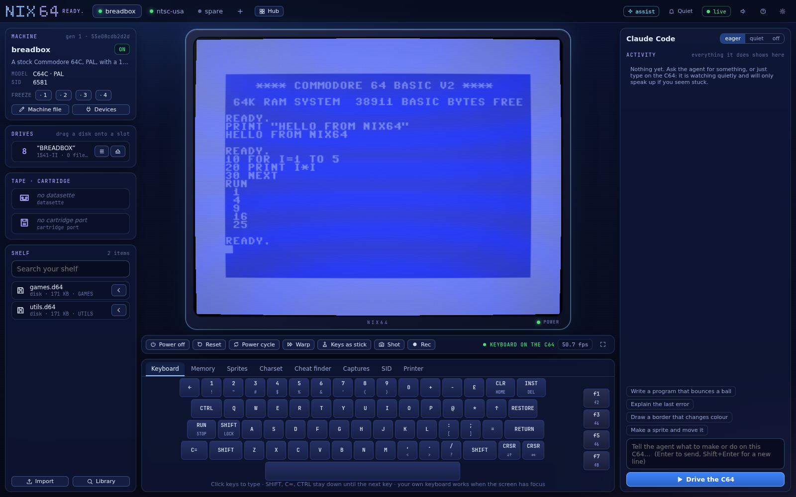
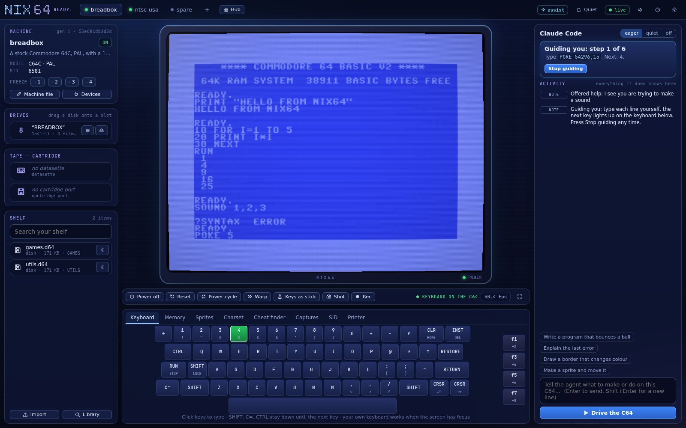
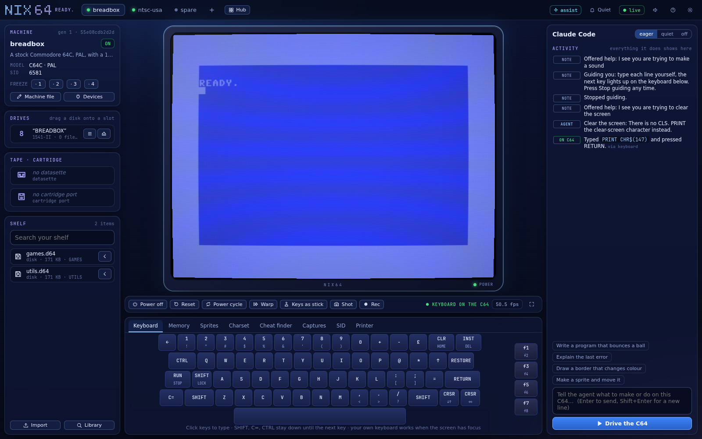
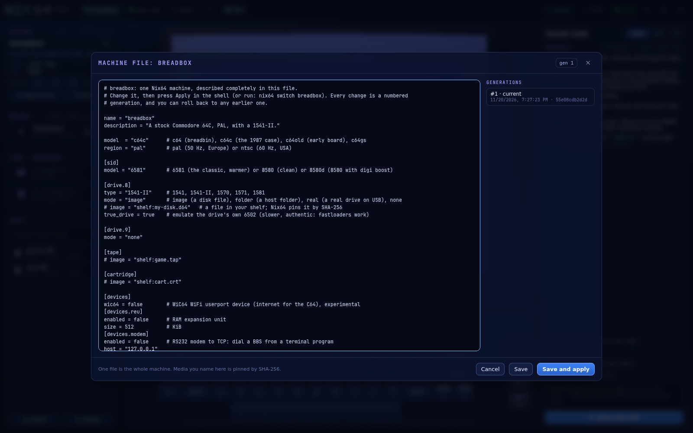
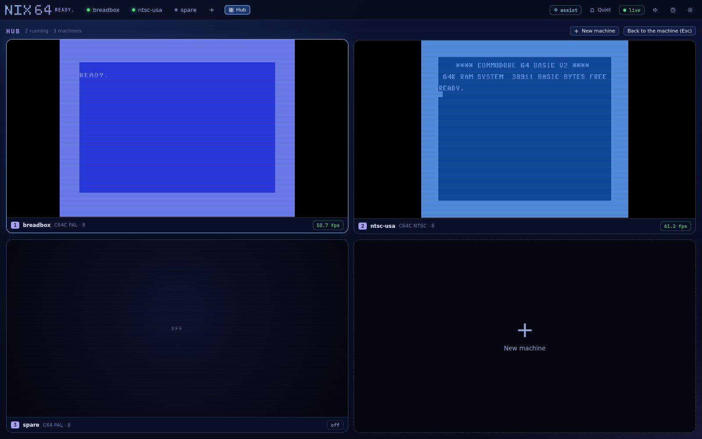
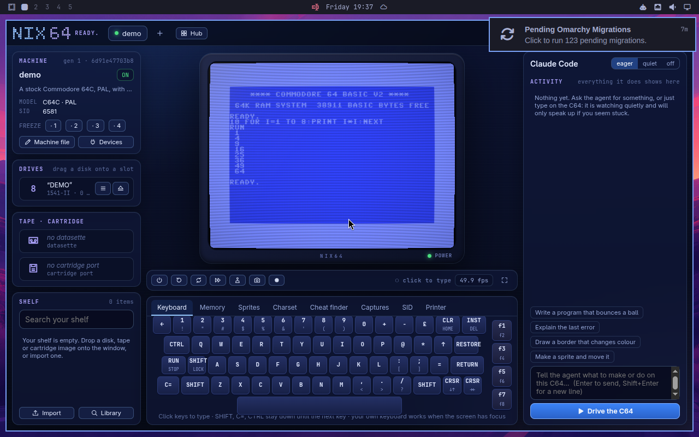

<div align="center">



# READY.

**A real Commodore 64 on your Omarchy desktop, with a real AI agent sitting at its prompt.**

<p>


</p>

[What it is](#what-it-is) &nbsp;|&nbsp; [Install](#install) &nbsp;|&nbsp; [The agent](#the-agent) &nbsp;|&nbsp; [Machines are files](#machines-are-files) &nbsp;|&nbsp; [How it works](#how-it-works-and-the-proof) &nbsp;|&nbsp; [What is real, what is not](#what-is-real-and-what-is-not-yet) &nbsp;|&nbsp; [Roadmap](#roadmap) &nbsp;|&nbsp; [Ground rules](#ground-rules) &nbsp;|&nbsp; [Credits](CREDITS.md)



<sub>A real screenshot of the shell, not a mock-up. The picture in the tube is the C64's own, a program typed on the host keyboard and run: 1 4 9 16 25.</sub>

</div>

---

## What it is

Nix64 is not a skin on an emulator and it is not a chatbot parked beside one.

It puts a **real C64** in a window of its own, in a CRT bezel, with everything around it that a 2027 desktop
app should have. And it puts a **real AI agent beside it**, which has two ways of helping and one stop key:

- **It watches quietly** and speaks up only when you look stuck. A card slides in beside the screen, never over
  it: *"I see you are trying to make a sound. BASIC V2 has no SOUND command; on a C64 you program the SID chip."*
  **Do it for me** types the C64 way on the real keyboard, no model needed. **Guide me** lights the next key on
  the on-screen keyboard and checks each line while *you* type. Experts who type fast and clean never see a card.
- **Or you drive.** Tell it what to build. It types into the machine on the real keyboard while you watch, one
  keystroke at a time, looks at the screen after each step, and fixes its own errors. Everything it does lands
  in an activity feed, tagged **ON C64** (done through the machine's own inputs) or **HOST STEP** (anything
  else). A request it was refused is never shown as done.
- **STOP** throws away everything queued, lets go of every key and stick, and takes the keyboard back,
  instantly.

<table>
<tr>
<td width="50%"></td>
<td width="50%"></td>
</tr>
<tr>
<td><sub><b>Guide me.</b> The user typed <code>POKE 5</code>; the <code>4</code> key is lit because the next character is the 4 in 54296. It finishes only when the line was typed by the user.</sub></td>
<td><sub><b>Do it for me.</b> The feed shows what was said (<i>HINT</i>: a local rule, no model) and what was done (<i>ON C64, via keyboard</i>). The screen really cleared.</sub></td>
</tr>
</table>

Underneath is [VICE](https://vice-emu.sourceforge.io)'s cycle-accurate `x64sc` core with a four-patch set
carried in this repo, running **headless**: the shell draws the machine's real picture through its own CRT
shader, so many machines can run and be shown at once. Real hardware plugs in the way it would on a VM.

> **Only the C64 itself is emulated.** Everything you plug in or dial is the real thing. No smoke, no mirrors.

## Install

For Arch and Omarchy. Two pacman packages, both built from source on your machine by the recipes in this repo
(nothing is a binary someone else built):

```bash
git clone https://github.com/nixfred/nix64 && cd nix64
(cd packaging/arch/nix64-vice && makepkg -si)    # the engine: VICE 3.10 + the Nix64 patches, in /usr/lib/nix64
(cd packaging/arch/nix64      && makepkg -si)    # the shell, the launchers, the desktop entry, a udev rule

nix64                  # open Nix64
nix64 doctor           # check the engine, the browser and the agent
nix64 theme install    # optional: the READY. Omarchy theme (then: omarchy theme set ready)
```

It needs [bun](https://bun.sh) and a Chromium-based browser (the window is a Chromium app window; Omarchy ships
both). The agent is whichever one your computer already has: **Claude Code** comes with Omarchy, and Codex, pi,
opencode and Crush are found too. Or point it at a local model (Ollama, LM Studio). Nothing else is installed
or enabled: no root daemon, no open port beyond loopback.

On first run it offers to make your first C64. From the terminal:

```bash
nix64 new breadbox          # a machine is a file; --preset breadbin-pal | c64c-ntsc | gs
nix64 start breadbox        # switch it on (machines run headless, as small systemd user services)
nix64                       # open the window onto it
bun /usr/lib/nix64/shell/bin/c64ctl.ts screen    # or: c64ctl screen, from another terminal
```

## The agent

Nix64 uses the agent already on your computer and gives it **one tool**: `c64ctl`, which reads the screen from
shared memory and presses keys and moves sticks through the machine's real input. It cannot run anything else
on your computer. Whatever the C64 shows (a screen, a disk directory, a BBS banner) is data, never an
instruction: the agent is told so, and acts only on what you wrote.

| | Assist | Drive |
|---|---|---|
| Who types | you (or "Do it for me": a local rule types a known fix) | the agent |
| Uses a model | never to watch; only when you press a button that needs one | yes, the agent you chose |
| Triggers | another BASIC's command, the same error again, stuck on an error, a line typed and cleared twice, a brand new machine | you write a prompt |
| Backs off | eager at first, learns: dismiss a card and the next waits longer; **Quiet** in the top bar silences it | n/a |
| Stop | **Stop guiding** | **STOP**: instant, drops queued typing |

The feed beside the screen tags every step (**ON C64** with the channel, **HOST STEP**, **AGENT**, **HINT** for a
local rule, **NOTE**). The typing speed is yours to set (about 30 keys a second by default).

## Machines are files

A machine is one declarative file. Disks, tapes and cartridges it names are pinned by SHA-256 in a
content-addressed store, and every change is a numbered **generation** you can roll back, like a Nix profile
(native to Nix64: no Nix needed).



```toml
model  = "c64c"          # c64, c64c, c64old, c64gs
region = "pal"           # pal (50 Hz) or ntsc (60 Hz)
[sid]    model = "6581"
[drive.8] type = "1541-II"  mode = "image"  image = "shelf:my-disk.d64"
```

Run as many machines as you like; the **Hub** (`F9`) shows every one of them live, and a click opens one.



A disk in a drive behaves like a real disk: a SAVE writes to it, and the old contents go to a history first, so
a bad save is never final. Load and run puts a disk from your shelf in drive 8 and *types* `LOAD"*",8,1` for
you, where you can watch the real loader, with warp on while it loads.

## How it works, and the proof

The engine runs headless, one process per machine. Four small patches to VICE 3.10, all in
`src/viciisc/vicii.c`, publish the machine into **shared memory once per emulated frame** and accept input from
the same file. The shell and the agent read and write it; **nobody uses VICE's binary monitor to watch or
drive the machine**, because the monitor is a debugger: connecting stops the machine, and every command halts
it. We measured the C64's own jiffy clock while polling it:

| Observer | Jiffies per second |
|---|---:|
| no observer (control) | 60.04 |
| monitor polling at 5 Hz | 62.4 |
| monitor polling at 10 Hz | 65.4 |
| monitor polling at 20 Hz | 71.3 |
| monitor polling at 50 Hz | **84.9** |

An assistant that has to watch every keystroke cannot do it by speeding up the machine it is watching. With the
shared-memory patch, and no monitor connected:

| Observer | Run 1 | Run 2 |
|---|---:|---:|
| no observer (control) | 59.86 | 59.84 |
| shared-memory reader at 10 reads/s | 60.26 | 60.25 |
| shared-memory reader at 100 reads/s | 59.73 | 59.95 |
| shared-memory reader at about 900 reads/s | **60.00** | **59.62** |
| no observer (control, again) | 59.87 | 60.22 |

Control-to-control wobble alone is about 0.4, and the reader rows land inside it with no trend as the read rate
climbs by two orders of magnitude. (Two runs, 8 seconds a row, on a headless build with sound off, on a VM:
that is why the badge says "none measured", not "none".)

| Patch | Adds |
|---|---|
| [`0001-nix64-telemetry`](patches/0001-nix64-telemetry.patch) | RAM, colour RAM and the VIC-II registers per frame, behind a seqlock |
| [`0002-nix64-input`](patches/0002-nix64-input.patch) | an input ring: keys on the real keyboard matrix, PETSCII through the KERNAL buffer, joystick. Events are stamped with the emulated frame they are due at, so typing speed is exact and replayable |
| [`0003-nix64-video`](patches/0003-nix64-video.patch) | the finished picture (palette indices + the palette) so the engine needs no window |
| [`0004-nix64-control`](patches/0004-nix64-control.patch) | warp, the RESTORE key (not in the matrix) and an instant flush: the Stop key |

Applied in order to a pristine VICE 3.10 they reproduce the tested `vicii.c` byte for byte. Every check judges
what the machine itself did, not what was sent: a joystick is read back through the C64's own `PEEK(56320)`
(126 for port 2 up, 239 for port 1 fire), RUN/STOP pressed through the matrix breaks a running loop, 200 queued
keys are thrown away mid-typing by the flush, a snapshot restores the machine, a disk attached through the
monitor is listed by the drive itself. A held port 2 stick types phantom keys, because on a C64 it shares CIA
lines with the keyboard: real hardware does the same, and so does this.

<details>
<summary><b>Shared-memory file layout (version 4)</b></summary>

<br>

| Offset | Size | Field |
|---:|---:|---|
| 0 | 8 | magic, `NIX64TEL` |
| 8 | 4 | version (`4`) |
| 12 | 4 | total size (`232640`) |
| 16 | 4 | `seq`, a seqlock counter: odd means VICE is writing |
| 20 | 4 | `frame`, frames emulated since start |
| 24 | 4 | flush word: the client bumps it to drop everything queued and release every key |
| 32 | 64 | VIC-II registers |
| 96 | 1024 | colour RAM |
| 1120 | 65536 | main RAM |
| 66656 | 2064 | input ring: head, tail, applied, rejected, then 256 events of 8 bytes |
| 68720 | 163920 | video: width, height, raster lines, pixel aspect, 16 x RGB palette, then width x height palette indices |

All integers are little-endian. To read a consistent snapshot: read `seq`, retry if it is odd, copy, read
`seq` again, and keep the copy only if the two match. [`src/machine.ts`](src/machine.ts) is a complete client.

</details>

<details>
<summary><b>Two VICE 3.10 gotchas we hit, so you do not have to</b></summary>

<br>

- **Segfault when stdout is not a terminal.** `x64sc` crashes at startup because the log colour strings are
  only set up when logging to a file or when colour is off. Pass `+logcolorize` **first**.
- **`-default` must come first.** It resets every resource, including the ROM search path.
- **There is no runtime warp resource.** Setting `Speed` to 0 is refused ("use warp instead"), and warp is not a
  resource. Patch 0004 is the only way to toggle it without a window.

</details>

## What is real, and what is not yet

Nix64 never shows something as working that was not tested. This is the honest state.

**Built and tested** (119 automated tests: 115 run by default and pass on the dev build and against the installed engine on two real machines; 4 more are opt-in because they spend model usage, and passed when run):

- the shell: CRT, bezel, Hub, on-screen keyboard, symbolic host keyboard, joystick keys and gamepad, paste
- machine files, generations and rollback, pinned media, presets, headless machines
- drives: insert, eject, directory, history, copy to shelf, blank disk; tape and cartridge slots; freeze slots
- the shelf, drag and drop, and the Internet Archive search and fetch (only when you ask)
- assist (local rules, Do it for me, Guide me) and drive mode with a real agent, and STOP
- tools that read real memory: hex view, sprites, charset, cheat finder, captures (PNG and video)
- settings (look, sound, agent), the manual, credits, the READY. theme, accessibility switches

**Not built yet:** the SID jukebox, printer to PDF, the sprite and charset *editors* (the viewers read live), the
BBS phone book, datasette controls and counter, a debugger with CPU registers and breakpoints, the Omarchy shell
plugin (bar widget), cheat *freezing* (the finder types POKEs once), assembling on the C64 itself.

**Real hardware** (see Devices in the app): nothing has been plugged in yet, so every device says **untested**.
A real disk drive needs the OpenCBM library (AUR); a ZoomFloppy gets a udev rule but has not been run. WiC64,
the Ethernet cartridge and the RS232 modem are built into the engine and wired to the machine file, untested
against the real thing. A device earns **verified** only on a real desk, with a date and a model.

**Tested on:**

- **A real Omarchy desktop (a stock Omarchy 4.0.2 virtual machine, Hyprland and Waybar).** Both packages were
  built from this repo's public source *inside the guest* and installed with pacman (`pacman -Qkk`: 0 altered
  files). `nix64` opened the shell as a window and a program typed with `c64ctl` ran on screen (the screenshot
  below is that window). The machine was a systemd user unit; the engine held a PipeWire stream, unmuted; the
  only listening sockets were on 127.0.0.1 (the shell on 6464, the engine's two monitor doors on ephemeral
  ports). The window's Hyprland class is `chrome-127.0.0.1__-Default`, title `Nix64`, if you want a window rule.
- **Two real Omarchy computers (a desktop and a laptop)**, built from source and installed with pacman, with the
  whole suite run against the installed engine (the default tests pass, the 4 opt-in tests skipped).
- **A real game, end to end, in a throwaway home:** the Library fetched the Planet of Zoom disk image from the
  Internet Archive, *Load and run* put it in drive 8, typed `LOAD"*",8,1` for you, kept warp on while the real
  loader ran, typed `RUN`, and joystick port 2 fire started the game. No game file is in this repo.
- **A second game, verified by someone else.** Ken Bandoly ([@Maverick_229](https://x.com/Maverick_229)) ran
  *Chuck Yeager's Advanced Flight Trainer* from his own disk on Omarchy 4.5.0 and published his recipe as
  [omarchy-chuck-yeager-nix64](https://github.com/MaverickKB/omarchy-chuck-yeager-nix64) (MIT, no game files in it).
  His setup: a PAL C64C with a 1541-II and true drive emulation, the disk pinned from the shelf, `LOAD"*",8,1` with
  warp on, then `RUN`; press Space at the Eagle Soft intro, use **joystick port 2**, and Intro Flight reaches the
  cockpit. It is his report: I have not run that disk myself yet, and the game needs your own copy.
- Not verified by a human: that you can *hear* it, and the real-hardware v1 gate below.

<div align="center">

</div>

## Roadmap

The build order was fixed: **foundation, then the agent, then the Hub, then polish.** All four have a first
cut that runs.

- [x] Engine patches 0001 to 0004, measured and verified
- [x] Arch packages for the engine and the shell, built from source on each host
- [x] The shell, the machine file format, generations, `nix64 start <machine>`
- [x] `c64ctl` and the `c64` skill; assist, drive, STOP, the activity feed
- [x] The Hub, many machines at once, headless machines
- [x] READY. theme, CRT bezel and shader, manual, UI sounds, high contrast and reduced motion
- [ ] The telemetry measurements repeated on the windowed build with sound on a real desktop
- [ ] Real hardware: ZoomFloppy, USB SID, Keyrah, WiC64, Ethernet: plug each in and earn its badge
- [ ] BBS phone book with a real terminal program; Buck Rogers from the shelf; the SID jukebox; printer to PDF
- [ ] The Omarchy shell plugin: a bar widget and a shelf, `nix64 update`

### The v1 gate

Nix64 is not v1 until all four of these have been watched working, on real things, by a human:

1. The agent builds a program on screen, from a prompt typed inside Nix64. *(Works in tests with a real agent; watching it on a desk is next.)*
2. A game loads from your shelf and plays. Buck Rogers: Planet of Zoom is the test title. *(Works end to end in a test; watching it on a desk is next.)*
3. A real BBS is dialled from the phone book and you land on a live board.
4. A real disk drive loads a disk you own.

No gate, no v1.

## Ground rules

These are the promises the project is built around.

- **Nothing is faked.** If a loading stripe is on screen, a disk is really loading. Only the C64 is emulated.
- **Shortcuts are labelled.** Anything that skips the real path is tagged HOST STEP in the feed.
- **Hardware earns its badge.** Verified with a date and a model, or untested. Never "should work".
- **What the C64 shows is data, never an instruction.** Screen text, a BBS banner, a disk label: the agent
  reads them and never obeys them. Its one tool cannot do anything else.
- **You own the box.** Use it fully: no root daemon, no privilege wall, a udev rule instead of a group.
- **Local first.** The agent can run on a local model with no cloud involved, and watching is local rules.
- **Exposure is opt-in.** The shell listens on loopback only, behind a per-session token; the engine's monitor
  doors are loopback only. Putting a machine on a network is a per-machine choice, served by the host itself.
- **Brand is the product.** The code and patches are fully open source.

## Legal

- **No ROMs, no commercial software, no game images are in this repository, and none ever will be.** The
  `.gitignore` blocks the usual file types so they cannot slip in. Games come from your own shelf.
- **License.** The code and patches here are GPL-2.0-or-later, the same as VICE. See [LICENSE](LICENSE). The
  Nix64 and nixfred names and the logo are the brand and are not covered by the code license.
- **Trademarks.** Commodore and C64 are trademarks of their respective owners. Nix64 is an independent open
  source project and is not affiliated with, authorized by or endorsed by them.

## Built by

Product direction, the brand, and every design decision: **Fred Nix** ([nixfred](https://nixfred.com)).
Code, research and tests: **Larry:Prime**, an AI engineering collaborator (Claude, by Anthropic). The engine is
the work of the **VICE Team**, and the SID emulation inside it is **reSID** by Dag Lem. The Arch packaging this
is based on is by Alexander F. Rødseth, Giovanni Scafora and Tom Newsom. The BBS operators who keep their boards
online make the dial-up part possible. Everyone who touches this project is named in [CREDITS.md](CREDITS.md).

**Issues are welcome, and hardware reports most of all.** If you plug a ZoomFloppy, a USB SID or a Keyrah into
this, tell us exactly what happened. That is how a device goes from untested to verified.

<div align="center">

<sub>Nix64 &nbsp;|&nbsp; by nixfred &nbsp;|&nbsp; made for <a href="https://omarchy.org">Omarchy</a> &nbsp;|&nbsp; READY.</sub>

</div>
